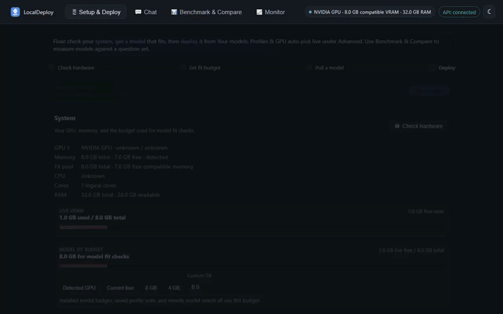

<p align="center">
  
</p>

<h1 align="center">LocalDeploy</h1>

<p align="center"><strong>Choose, run, and compare local AI models on your own hardware.</strong></p>

<p align="center">
  <a href="https://github.com/oney-erge/LocalDeploy/actions/workflows/ci.yml"></a>
  <a href="https://pypi.org/project/localdeploy/"></a>
  <a href="LICENSE"></a>
  
</p>

<p align="center">
  
</p>

LocalDeploy helps you answer a practical question before you download a model:
will it fit and run well on this machine? It finds the local models that fit
your hardware, tests them on your own questions, and connects the winner to your
apps. It detects hardware, estimates memory use, manages models across Ollama,
llama.cpp, LM Studio, and vLLM, records benchmarks, and serves the deployed
model through several APIs. It runs locally, has no telemetry, and does not
provide cloud inference.

## Quick start

With Python 3.11+ and [Ollama](https://ollama.com) installed:

```bash
pip install localdeploy
localdeploy        # opens http://localhost:8000/ui
```

The UI guides you through hardware detection, model search, a fit estimate,
deployment, chat, and benchmarking. If you use `uv`, `uvx localdeploy` runs it
without a permanent install.

Open **Get a model**, choose a use case and context length, and review the
recommended model's memory and download estimates. Start an installed model or
explicitly download one, then use **Chat** and **Benchmark** to see how it
performs on your machine. [A worked comparison](docs/FIT_COMPARISON.md) shows
how to inspect estimates against another tool.

Need help setting up Python or Ollama? Clone the repository and run its launcher:

```bash
git clone https://github.com/oney-erge/LocalDeploy.git
cd LocalDeploy
./run.sh           # Linux; macOS: ./run.command
```

On Windows, use `run.bat`. The launchers can prepare the environment and open
the UI; [Installation](docs/INSTALL.md) covers prerequisites, Docker, and the
Windows setup script. Desktop builds are experimental and unsigned; see
[Packaging](docs/PACKAGING.md).

## What it helps with

- Find models from Ollama, Hugging Face, ModelScope GGUF repositories, local
  GGUF files, or direct URLs.
- Estimate model fit before download, including likely CPU offload, and compare
  quantizations with the quant advisor.
- Pull, deploy, switch, unload, and remove local models. A llama.cpp chat model
  can be started, switched, and stopped by LocalDeploy itself.
- Chat with text, images, and documents, then compare installed models on the
  built-in or your own question sets using measured latency, throughput, memory,
  and accuracy results.
- Monitor CPU, RAM, VRAM, model placement, and request timing while a model runs.
- Export a deployment as a manifest, check it on another machine, and recreate
  it there.

## Ways to use it

Once a model is running, your tools can reach it in several ways:

| Way in | What it is for |
|---|---|
| Web UI at `/ui` | Check hardware, find, pull, and deploy models, chat, benchmark and compare, monitor |
| OpenAI-compatible API: `/v1/chat/completions`, `/v1/responses`, `/v1/embeddings`, `/v1/models` | Any app or SDK that speaks the OpenAI API, with streaming, JSON-schema output, and tool calls returned to your app |
| Native API: `/chat`, `/vision`, `/estimate`, `/benchmark` | Requests by profile, with per-request context limits, safe mode, image input, and a safety estimate before you send |
| Control API: about 50 endpoints | Script what the UI does: hardware and fit checks, recommendations, search, pull, serve, switch, free the GPU, benchmark, compare, export. The interactive reference is at `/docs` |
| Decision API: `/v1/systemone` | Small classifiers that answer typed questions about a piece of text with a probability for every option |
| Client setups | Ready configuration for Open WebUI, AnythingLLM, Continue, Cline, curl, Python, JavaScript, and Docker Compose, generated from a running model |
| Deployment manifests | Record the model digest, quantization, runtime settings, hardware, and measurements, then recreate the deployment elsewhere |
| Terminal | `scripts/chat.ps1` for chat and `compare_models.py` for side-by-side runs; see [CLI](docs/CLI.md) |

[API options](docs/API_OPTIONS.md) has request examples for the native,
OpenAI-compatible, and decision APIs. The control API is described at `/docs`.

The **decision API** is optional. It runs small models (vLLM Semantic Router d3,
LiquidAI d1, Laya) that return a probability for every option in one pass, so an
app can classify or route locally and call a language model only when the answer
is not confident. On a laptop CPU, the 0.85B d3-lite model routed agent messages
to 15 routes as accurately as an 8B language model on one set (93% against 92%
of 98 messages), slightly less on another (84% against 88% of 43), in 0.5 s
instead of 15 s. The [raw runs and method](benchmarks/decision-routing/README.md)
are in the repository, and [Decision models](docs/API_OPTIONS.md#decision-models)
shows how to enable one.

## Where it fits

- If you already know which model you want and only need terminal chat, Ollama
  may be enough.
- If you use a front end such as Open WebUI, Continue, or Cline, LocalDeploy is
  the layer underneath: it helps choose and run the model and generates those
  tools' connection settings.
- If you are choosing between models for a particular machine, it runs the
  candidates on your own questions and records what you measured.

## What to expect

Fit estimates are guidance, not guarantees. Driver versions, context length,
quantization, desktop GPU use, and the runtime all affect actual memory use.
LocalDeploy records what happened after deployment so later estimates can be
adjusted for that machine.

It works with Ollama, llama.cpp, LM Studio, vLLM, and other loopback
OpenAI-compatible runtimes. Runtime URLs must remain local. An `API_TOKEN`
is an optional shared token, not full authentication. Keep the service on
localhost; it has no TLS, user isolation, or rate limiting. Tool calls are
returned to clients and are never executed by LocalDeploy.

Model search and the UI's release check can contact external services.
Set `OFFLINE=true` to disable those requests. Separately installed runtimes
have their own network settings; see [Security](SECURITY.md).

## Documentation

| Guide | Use it for |
|---|---|
| [Installation](docs/INSTALL.md) | Launcher commands, Docker, and setup alternatives |
| [UI guide](docs/UI.md) | Choosing, deploying, chatting with, and benchmarking models |
| [API options](docs/API_OPTIONS.md) | Native, OpenAI-compatible, and decision APIs, with request examples |
| [CLI](docs/CLI.md) | Commands and automation |
| [Models](docs/MODELS.md) | Runtimes, model discovery, and fit estimates |
| [Screenshots](docs/SCREENSHOTS.md) | The complete UI tour |
| [Packaging](docs/PACKAGING.md) | Experimental desktop builds and signing limitations |
| [Contributing](CONTRIBUTING.md) | Development setup and verification |

MIT licensed. Built by [Oney Erge](https://oneyerge.com).
